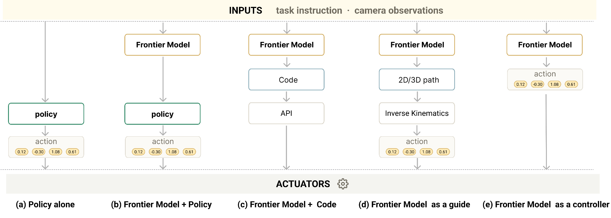

# 2Bridge

**Bridging Frontier Reasoning and Robot Execution: From Autonomous Demonstration Generation to Dense Language Supervision**

[**Paper**](https://arxiv.org/pdf/2610.03615) · [**arXiv**](https://arxiv.org/abs/2610.03615) · [**Project webpage**](https://pearls-lab.github.io/2bridge/)

## Overview

Frontier models can guide complex tasks, but their inference latency limits direct robot control. We study two complementary ways to connect frontier reasoning with fast local policies:

1. **Autonomous demonstration generation.** A frontier model generates robot demonstrations from in-context examples, including corrective segments that show how to recover from physical errors. The generated demonstrations supplement human data for local-policy training.
2. **Dense language supervision.** We describe the same demonstrations at primitive, atomic, and composite levels, with varied descriptions at each level, to improve how reliably the local policy follows instructions.

We evaluate instruction following in RoboCasa 365 and BEHAVIOR-1K and combine both approaches on a physical crossword task. The [project webpage](https://pearls-lab.github.io/2bridge/) presents rollout videos, correction examples, and results.



## Code and documentation

The current release provides **π0.5 policy training and inference** on local LeRobot datasets and a **frontier planner → local monitor → policy** harness with RoboCasa and BEHAVIOR-1K adapters. The planner generates a plan once per episode; the local monitor advances through its subgoals as the policy executes.

| Component | Documentation |
| --- | --- |
| Policy training, checkpoints, and inference | [Training guide](docs/policy-training.md) |
| Dataset format, cameras, instructions, and preprocessing | [Dataset guide](docs/datasets.md) |
| Frontier harness and simulator setup | [Harness guide](docs/frontier-harness.md) |

## Getting started

Use Python **3.11 or 3.12** in a dedicated environment. Full π0.5 fine-tuning needs a CUDA GPU with sufficient memory.

```bash
git clone https://github.com/pearls-lab/2bridge.git
cd 2bridge
python3.11 -m venv .venv
. .venv/bin/activate
python -m pip install --upgrade pip
python -m pip install -e .
cp configs/generic.toml configs/my_dataset.toml
```

Provide a local LeRobot dataset, a compatible OpenPI π0.5 PyTorch checkpoint, and its matching PaliGemma tokenizer. Edit `configs/my_dataset.toml` to set their paths, camera and state/action fields, and held-out episode IDs. Paths resolve relative to the TOML file. The [training guide](docs/policy-training.md) covers supported assets and configuration in detail.

```bash
2bridge inspect --config configs/my_dataset.toml --samples 8
2bridge train --config configs/my_dataset.toml
```

Start from [the generic configuration](configs/generic.toml) for a new dataset, or use [the crossword example](configs/crossword.toml) for the paper's physical-task recipe. For the planner–monitor–policy setup, follow the [harness guide](docs/frontier-harness.md); the policy, monitor, and simulator use separate environments.

## Citation

If you use this work, please cite:

```bibtex
@misc{kim2026bridging,
  title = {Bridging Frontier Reasoning and Robot Execution:
           From Autonomous Demonstration Generation to Dense Language Supervision},
  author = {Kim, Bosung and Trevithick, Alexander and Wang, Ruiyi
            and Ammanabrolu, Prithviraj},
  year = {2026},
  eprint = {2610.03615},
  archivePrefix = {arXiv},
  url = {https://arxiv.org/abs/2610.03615}
}
```

## License and acknowledgments

The code is released under [Apache 2.0](LICENSE). The policy backend builds on [OpenPI](https://github.com/Physical-Intelligence/openpi). Model weights and datasets retain their respective licenses.
